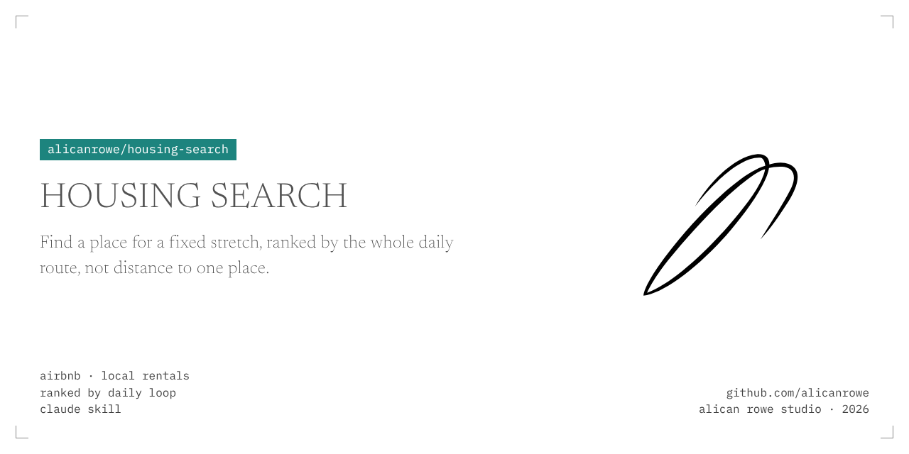
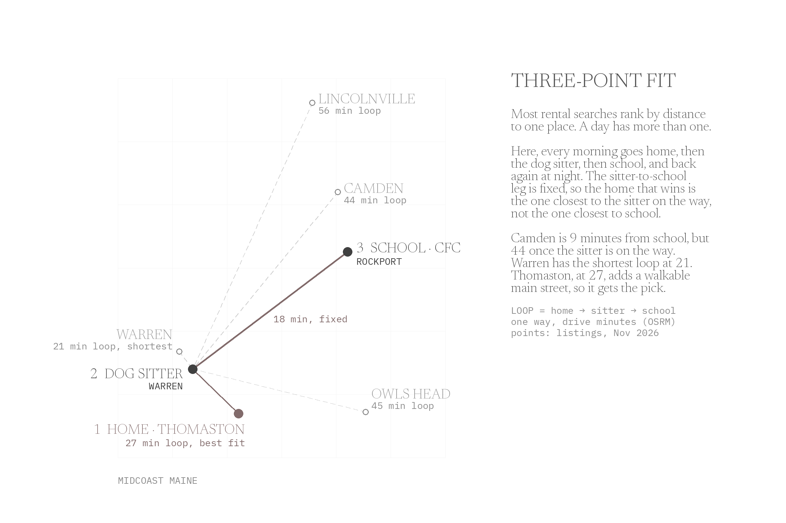
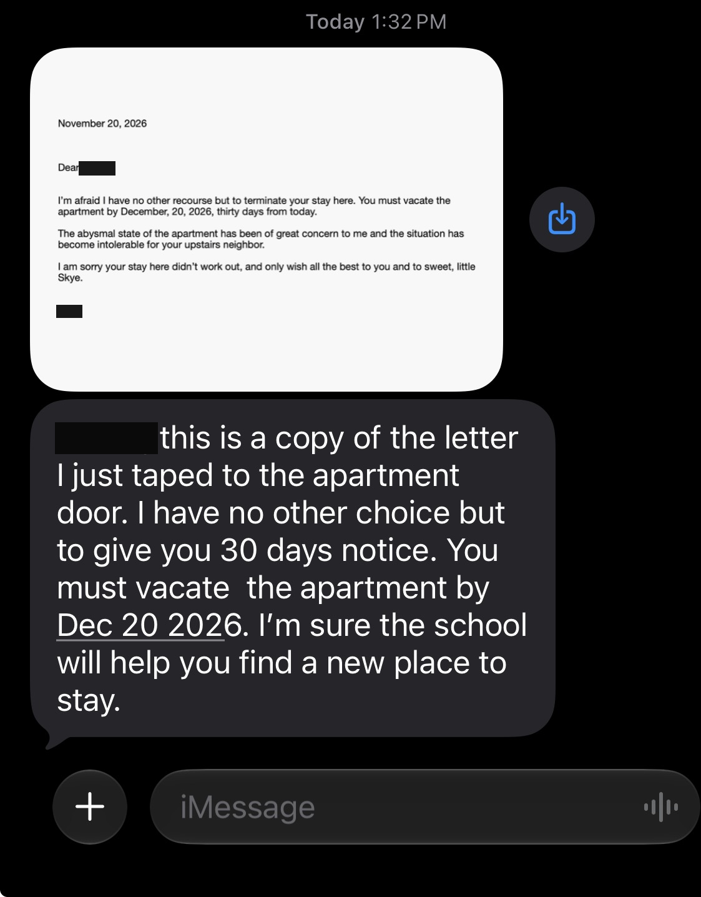
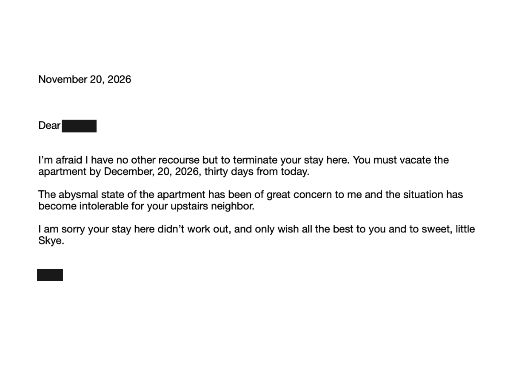

# Housing search skill

A Claude skill for finding a place to live for a fixed stretch, such as a school year or a contract. Claude pins the end date from the official source, searches Airbnb and local monthly and winter rentals, filters by pets, all-in budget and walkability, and ranks a shortlist by drive time to the places you care about. You book; Claude never contacts hosts without your go ahead.

## Why this exists

In November 2026, partway through my Nine-month Comprehensive at the Center for Furniture Craftsmanship in Rockport, Maine, my landlord taped a note to my door and texted me a copy. I had 30 days to move out, in the middle of a Maine winter, with a full-time program, a small dog, and a dog sitter I drop her off with every morning.

  
  

Airbnb had nothing that fit: no whole place that takes dogs, near school, from that day through graduation, under $2,000 a month. The places that did fit were local winter rentals on Craigslist and TurboTenant, and the best one wasn't the one closest to school. My day runs home, then the sitter, then school, then back again, so the right home is the one that keeps that whole loop short (the map above). I built this skill out of that search so the next one starts from what I already know: the dog, the sitter, the loop, the budget. It doesn't make me answer all of that again while I'm packing.

## What's in it
- `SKILL.md`: the process.
- `references/messages.md`: the humanising pass for landlord messages.
- `references/profile-template.md`: the standing facts to keep about the renter (pets, anchors, budget), stored outside the skill.
- `images/`: the map and the notice that started it (names blacked out).
- `scripts/airbnb_search.js`, `scripts/listing_text.js`: Playwright helpers that print Airbnb search cards and full listing text.
